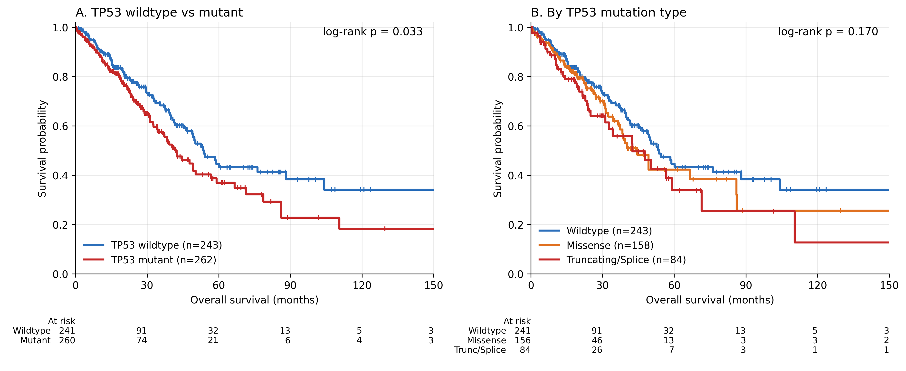

# TP53 Mutation Types and Overall Survival in Lung Adenocarcinoma

**Does the *type* of TP53 mutation in a lung adenocarcinoma predict how long a patient survives — and does that hold up once tumour stage is taken into account?**

An independent research project using public data from the Cancer Genome Atlas (TCGA), accessed through [cBioPortal](https://www.cbioportal.org/).

📄 **Full report:** [`report/TP53_LUAD_Research_Report.pdf`](report/TP53_LUAD_Research_Report.pdf)

---

## Key findings

| Question | Result |
|---|---|
| How common are TP53 mutations in LUAD? | 295 of 566 patients (**52%**); 61% of mutation records are missense, 93% of which hit the DNA-binding domain |
| Do TP53-mutant patients survive less long? | Yes, before adjustment: median OS 42.3 vs 53.7 months, log-rank **p = 0.033** |
| Does survival differ by mutation type? | Not significantly: wildtype vs missense vs truncating/splice, log-rank **p = 0.170** |
| Does it hold after adjusting for stage? | Mostly not. Mutant vs wildtype HR 1.37 → **1.21 (p = 0.22)**; missense HR **0.99**; truncating/splice HR **1.52 (95% CI 1.01–2.29, p = 0.043)** |
| What predicts survival most strongly? | Tumour stage: HR 2.5–3.9 for stage II–IV vs stage I |

**Unexpected result:** I predicted truncating mutations would have the worst survival. The direction held, but the overall TP53 effect largely disappeared once stage was included, and the remaining truncating/splice signal is borderline. The study had only ~48% power to detect a hazard ratio of 1.5.



---

## Data

| | |
|---|---|
| Dataset | Lung Adenocarcinoma (TCGA, PanCancer Atlas) |
| cBioPortal study ID | `luad_tcga_pan_can_atlas_2018` |
| Files used | `data_mutations.txt`, `data_clinical_patient.txt` |
| Patients | 566 (all sequenced); 505 with survival data; 182 deaths |

The raw files are **not** included in this repository (they are large and freely downloadable). See [`data/raw/README.md`](data/raw/README.md) for download steps.

`data/processed/` contains the patient-level analysis table produced by step 1:

| Column | Meaning |
|---|---|
| `PATIENT_ID` | TCGA patient ID (e.g. `TCGA-05-4382`) |
| `OS_MONTHS`, `OS_STATUS` | Overall survival time and status (`0:LIVING` / `1:DECEASED`) |
| `AGE`, `SEX` | Age at diagnosis, sex |
| `AJCC_PATHOLOGIC_TUMOR_STAGE` | AJCC pathologic stage (e.g. `Stage IB`) |
| `TP53_status` | `Mutant` or `Wildtype` |
| `TP53_mutation_types_found` | Simplified mutation class(es), e.g. `Missense` or `Missense;Nonsense` |
| `TP53_n_mutations`, `TP53_protein_changes` | Number of protein-altering TP53 mutations and their protein changes |

## Repository structure

```
LUAD-TP53-survival/
├── README.md
├── RESEARCH_LOG.md             ← dated record of what I did and learned
├── requirements.txt
├── src/
│   ├── 01_build_phase1_table.py   Phase 1: TP53 extraction, sample→patient mapping, merge, QC
│   ├── 02_mutation_landscape.py   Analysis 1: mutation frequency, protein map, study flow
│   └── 03_survival_analysis.py    Analyses 2–4: Kaplan–Meier, log-rank, Cox (+ stage), checks
├── data/
│   ├── raw/                       (not tracked; download instructions inside)
│   └── processed/                 patient-level table + TP53 mutation records
├── results/
│   ├── figures/                   Figures 1–4 and S1 (PNG, 300 dpi)
│   ├── tables/                    all result tables (CSV)
│   └── survival_results.json      every number quoted in the report
├── report/
│   └── TP53_LUAD_Research_Report.pdf
└── archive/                       first versions of my scripts and figure (kept for history)
```

## How to reproduce

```bash
# 1. Get the code
git clone https://github.com/<your-username>/LUAD-TP53-survival.git
cd LUAD-TP53-survival

# 2. Set up Python (3.10 or newer)
python -m venv .venv
source .venv/bin/activate          # Windows: .venv\Scripts\activate
pip install -r requirements.txt

# 3. Download the raw data into data/raw/ (see data/raw/README.md)

# 4. Run the three steps in order
python src/01_build_phase1_table.py
python src/02_mutation_landscape.py
python src/03_survival_analysis.py
```

Each script prints its results and a QC summary to the terminal. Outputs are written to `data/processed/` and `results/`.

## Methods in brief

1. **Phase 1:** filter `data_mutations.txt` to TP53 (318 records, 295 samples). Convert sample barcodes to patient IDs (first three parts). Drop silent variants. Collapse to one row per patient. Merge with clinical data. Patients with no TP53 record are wildtype, which is valid because all 566 samples are in the study's "sequenced" case list.
2. **Classification:** Missense / Truncating-Splice (nonsense, frameshift, splice site) / Other-mixed. Groups were merged after looking at group *sizes*, not survival.
3. **Survival:** Kaplan–Meier curves and log-rank tests. Cox models: `Survival ~ TP53 type + Stage`, plus age/sex as a check. Schoenfeld proportional-hazards test. Three sensitivity analyses. All done with [lifelines](https://lifelines.readthedocs.io/).

## Limitations

This is an observational, retrospective study, so it shows association, not causation. TCGA patients mostly had early-stage, surgically resected tumours, and treatment was not modelled. The mutation subgroups are small and follow-up is short (median 28.7 months). Many tests were run, so the borderline truncating/splice result should be treated with caution. See Section 5 of the report.

## Acknowledgements

The results shown here are based upon data generated by the TCGA Research Network: https://www.cancer.gov/tcga. Data were accessed through cBioPortal for Cancer Genomics (Cerami et al., *Cancer Discov* 2012; Gao et al., *Sci Signal* 2013). Clinical endpoints follow the TCGA Pan-Cancer Clinical Data Resource (Liu et al., *Cell* 2018).

**Use of AI tools:** Claude (Anthropic) was used to review and refactor the analysis code, cross-check the statistics and help draft the report.

## Author

Allen Liang · 2026

## License

Code: MIT License (see `LICENSE`). TCGA data are subject to the [NCI GDC data use policies](https://gdc.cancer.gov/access-data/data-access-processes-and-tools).
